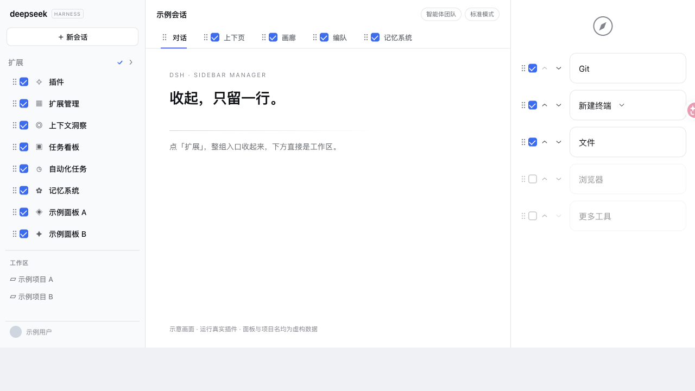
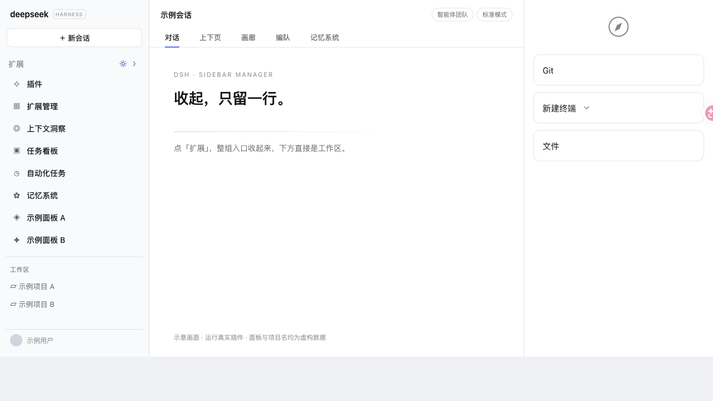

# dsh-sidebar-manager

让 DSH 的扩展入口、视图标签和右侧面板入口支持**排序、隐藏**，左侧扩展组还可折叠。

[](https://www.npmjs.com/package/dsh-sidebar-manager) [](https://github.com/deepseek-ai/deepseek-harness) [](./LICENSE) [](https://github.com/deepseek-ai/deepseek-harness)


<details>
<summary>静态界面预览</summary>






</details>

> 动图与截图在[匿名示意页](https://github.com/zuojinxin/dsh-sidebar-manager/blob/main/docs/preview.html)中**运行真实插件**生成，面板名与工作区名为虚构数据，不含任何真实会话或账号。

## 功能

- **折叠**：点标题行收起左侧整组扩展入口
- **隐藏**：点齿轮进入编辑态，点整行即可切换左侧入口、视图标签或右侧面板入口的显示（勾选框照样可用）
- **排序**：编辑态下拖整行调整顺序，左右侧栏上下拖，视图标签左右拖；右侧也可点上移、下移按钮

设置自动保存，刷新后仍在。先在右侧点「＋」打开「开始」页，再点左侧齿轮即可编辑右侧入口。右侧设置独立保存，适用于文件、终端、Git、浏览器等入口及「更多工具」，不会关闭已打开的面板。退出编辑后隐藏的入口会消失；再次进入编辑即可恢复。

## 安装

从 npm 安装：

```bash
dsh plugin --profile desktop add dsh-sidebar-manager
```

从 GitHub 安装：

```bash
dsh plugin --profile desktop add 'github:zuojinxin/dsh-sidebar-manager'
```

装完重启 DSH 桌面版生效。

## 说明

- 左侧及顶部功能面向 DeepSeek Harness 0.2.1-rc.2；右侧按 DSH 0.2.2-rc.1 的默认「开始」页结构适配。插件依赖宿主 DOM 标记和 CSS 类名，DSH 升级或替换默认开始页后可能需要适配。
- 「对话」标签不可隐藏（默认视图，藏掉中间会变空）；正在看的标签也不可隐藏。
- 右侧偏好沿用现有 v2 本地记录；降级到 0.10.1 或更早版本会被旧版重写，之后再升级需重新设置右侧入口。
- 禁用插件后，页面上由它添加的元素和样式会全部移除。

## 开发

```bash
npm install --no-save jsdom
npm test
```

浏览器回归通过 ego-browser 运行匿名示意页中的真实插件，验证右侧入口的显示、排序、刷新恢复和退出清理：

```bash
ego-browser skill
npm run test:browser
```

这项检查需要可用的 ego-browser；它不启动 DSH Desktop，也不读写现有 DSH profile。示意页验证不代表已在原生 Desktop 窗口验收。

## 许可

[MIT](./LICENSE)，基于 [nico-zhuang/dsh-sidebar-nav-collapse](https://github.com/nico-zhuang/dsh-sidebar-nav-collapse) 重写。
